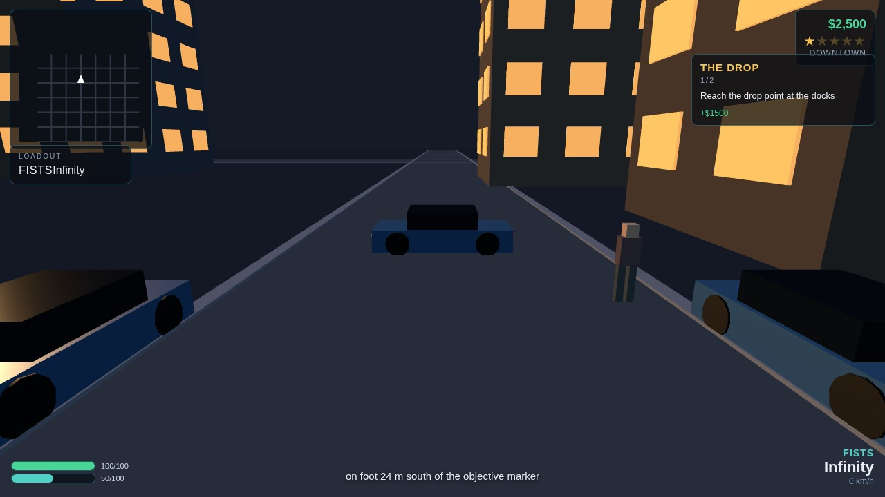

# Sunset Harbor

An original open-world crime game that runs in the browser on three.js, set in a harbour city at dusk — drive, walk, fight, take missions and outrun a five-star police response.

## Controls

WASD or arrows to move, Shift to run, Space for the handbrake, F to enter or exit a vehicle, R to reload, 1-5 to switch weapons, click to shoot, Escape to pause.

## Features

- procedural harbour city with named districts
- drivable vehicles with arcade physics
- ambient traffic and pedestrians
- a five-star wanted system with police cruisers
- missions with staged objectives
- a weapon loadout
- a HUD with minimap, mission tracker, police proximity readout and wanted stars
- localStorage save and load

## Running it

Node 22.18 or later, then `node serve.ts` and open the printed address. To produce the build output run `node main.ts`, which writes out/dossier.json.

## Project layout

- game/index.html
- game/src/main.js
- modules: city, player, vehicles, traffic, pedestrians, combat, police, missions, hud, save, shots
- main.ts
- serve.ts

## Screenshots

*A police chase through the harbour streets.*

*Cruising the city at dusk.*

*A staged mission objective.*

*Exploring on foot.*

Built for the make.fun gta6-01 bounty.
