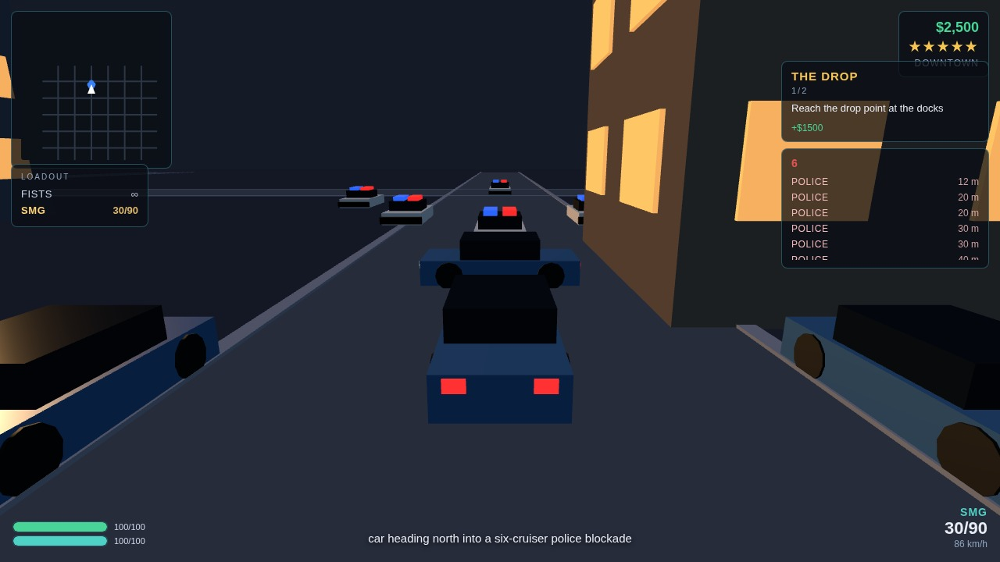
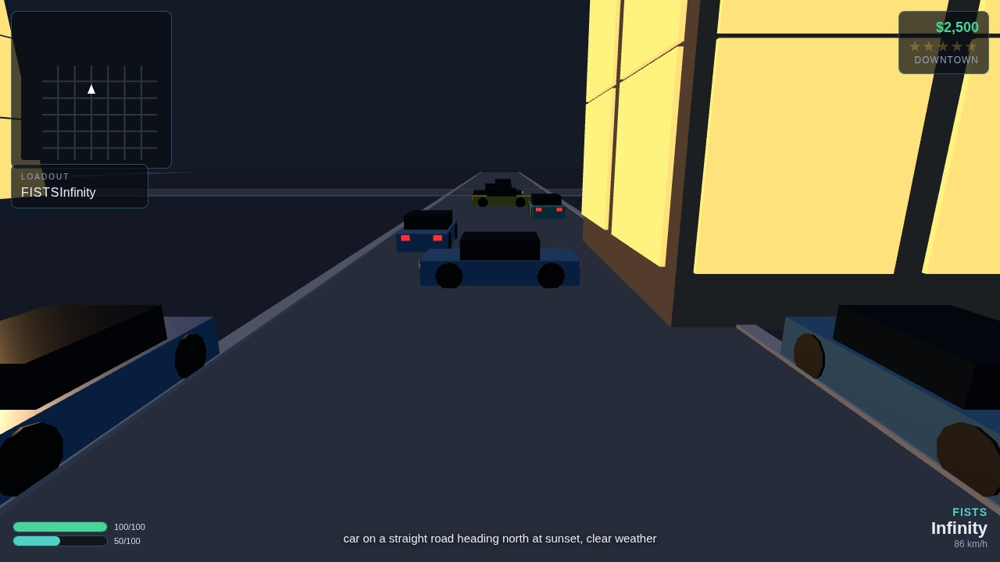
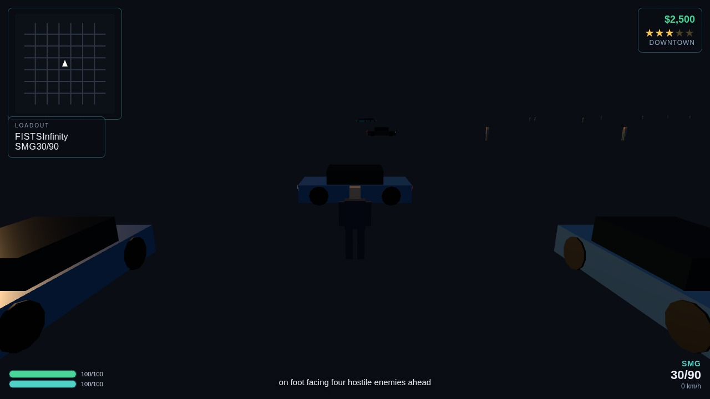

# Sunset Harbor

Sunset Harbor is an original open-world crime game that runs in the browser on three.js, set in a harbour city at dusk. Drive, walk, fight, take missions and outrun a five-star police response.

## Controls

WASD or arrows to move, Shift to run, Space for the handbrake, F to enter or exit a vehicle, R to reload, 1-5 to switch weapons, click to shoot, Escape to pause.

## Features

- Procedural harbour city with named districts
- Drivable vehicles with arcade physics
- Ambient traffic and pedestrians
- A five-star wanted system with police cruisers
- Missions with staged objectives
- A weapon loadout
- A HUD with minimap, mission tracker, police proximity readout and wanted stars
- localStorage save and load

## Running it

Node 22.18 or later, then `node serve.ts` and open the printed address. To produce the build output run `node main.ts`, which writes out/dossier.json.

## Project layout

- game/index.html
- game/src/main.js
- Modules: city, player, vehicles, traffic, pedestrians, combat, police, missions, hud, save, shots
- main.ts
- serve.ts

## Screenshots

[make.fun · gta6-01](https://make.fun/bounty/gta6-01)

Built for the make.fun gta6-01 bounty.
